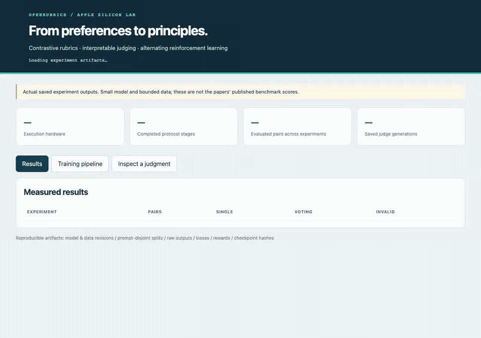
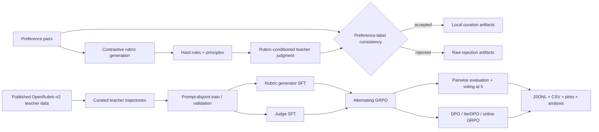
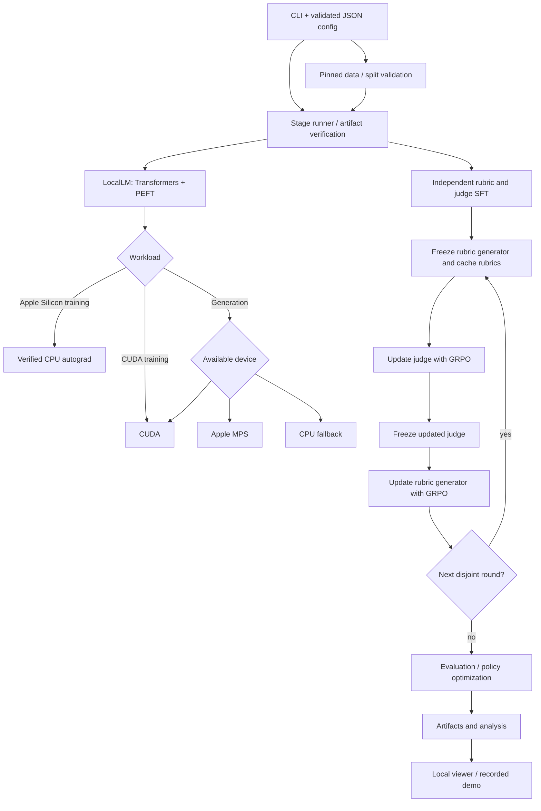
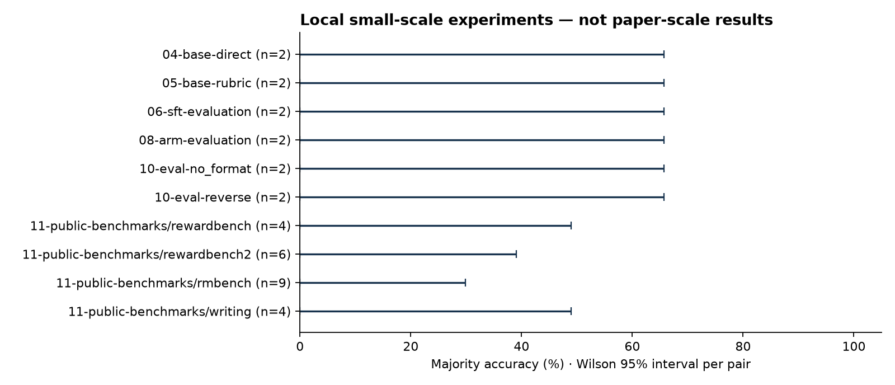
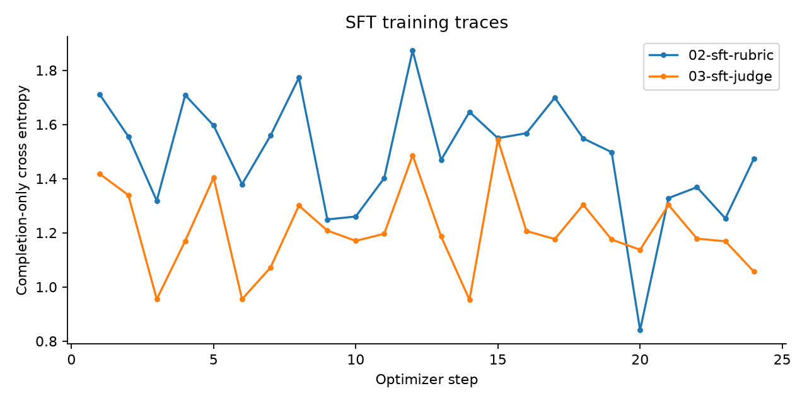

# RubricLab

**English** | [简体中文](README.zh-CN.md)

An Apple Silicon–ready research toolkit built on OpenRubrics for rubric-based reward modeling, with end-to-end training, evaluation, and reproducible experiment analysis.

Generate explicit evaluation rubrics, train a rubric generator and a rubric-aware judge, and optimize them with alternating reinforcement learning. This repository preserves the original **OpenRubrics / Rubric-RM / Rubric-ARM** implementation and adds an end-to-end local research workflow for **M1 Macs**, with verified CPU training, MPS inference and recorded CPU inference fallback.

[OpenRubrics paper](https://arxiv.org/abs/2510.07743) · [Rubric-ARM paper](https://arxiv.org/abs/2602.01511) · [Models and data](https://huggingface.co/OpenRubrics) · [Paper coverage audit](docs/PAPER_COVERAGE.md) · [Original README and citations](docs/UPSTREAM_README.md)

> **Scope:** The local workflow executes the central algorithms at reduced scale. It does **not** reproduce all published experiments or claim the papers' scores. Full-parameter 8B training does not fit a 16 GB M1. Missing paper-specific evaluation data, external judges and unexecuted experiments are listed in the [coverage audit](docs/PAPER_COVERAGE.md).

## Demo

The recording shows the local viewer reading **actual saved model outputs and measured results**, including failures. It replays completed experiments; it does not suggest that training finishes in the video's duration.

[](docs/assets/demo.mp4)

[Watch/download MP4](docs/assets/demo.mp4) · [Autoplay video page](docs/demo.html)

<video src="docs/assets/demo.mp4" poster="docs/assets/demo-poster.png" autoplay muted loop playsinline controls width="960">
  <a href="docs/assets/demo.mp4">Open the demo video</a>
</video>

GitHub README rendering does not provide a dependable way to force MP4 autoplay. The GIF supplies an automatic looping preview directly in the README; the MP4 is also included. The standalone HTML page uses `autoplay muted loop playsinline`, subject to browser preferences. No external video host or upload is required.

## Run on an M1 Mac

Tested locally on **Apple M1 Pro, 16 GB unified memory, arm64 macOS, Python 3.11**. Use a native arm64 Python, not Rosetta. FFmpeg is needed only to regenerate the video.

If needed, Homebrew can install the prerequisites with `brew install python@3.11`; add `brew install ffmpeg` to regenerate the recording.

```bash
git clone https://github.com/InfronAI/RubricLab.git
cd RubricLab
python3.11 -m venv .venv
source .venv/bin/activate
python -m pip install -e '.[dev,demo]'
openrubrics doctor

# Use the committed small dataset slice.
openrubrics run --config configs/m1.json --data data/m1 \
  --output experiments/my-m1-run

openrubrics report experiments/my-m1-run
openrubrics demo --run experiments/my-m1-run
# Open http://127.0.0.1:8765
```

The first model load downloads public weights if not already cached. The default workflow uses **no API keys, paid model calls, CUDA packages or remote compute**. The main profile includes three ARM rounds, two ablations and five-vote benchmark tests; budget hours for this full local protocol. Start with the smoke profile below for a shorter execution check.

To rebuild the data, or run a shorter mechanism check:

```bash
# Rebuild into a new directory, retaining the existing provenance.
openrubrics prepare --config configs/m1.json --output data/my-m1
openrubrics run --config configs/m1.json --data data/my-m1 \
  --output experiments/my-rebuilt-run

# Smaller model and training budget.
openrubrics prepare --config configs/smoke.json --output data/my-smoke
openrubrics run --config configs/smoke.json --data data/my-smoke \
  --output experiments/my-smoke-run
```

| Profile | Base model | Purpose |
|---|---|---|
| `configs/m1.json` | Qwen2.5-0.5B-Instruct | SFT, 3 ARM rounds, ablations, public benchmark slices, policy optimization |
| `configs/smoke.json` | SmolLM2-135M-Instruct | Shorter mechanism check; one ARM round, no public benchmark sweep |
| Original GPU configs | Qwen3-4B/8B and full tuning | Original model scale; separate CUDA environment and sufficient hardware |

Both local profiles use real pretrained models and gradient updates. A small model can produce invalid judgments, empty filtering results or uninformative rewards; those outcomes are saved rather than replaced with expected answers.

The [completed CPU smoke run](experiments/smoke-cpu-20261116/analysis/NOTES.md) took about 10 minutes on this machine and passed verification of all 13 stage receipts. Its small model produced invalid held-out judgments; completion demonstrates execution, not alignment quality.

## Apple Silicon implementation

The [engineering notes](docs/M1_ENGINEERING.md) connect each change to its validation and measured limits.

- One installable package and CLI connect preparation, training, evaluation, policy optimization, reports and the viewer.
- MPS inference on Apple Silicon, with **CPU autograd for training and policy/reference scoring**. A fixed-weight gradient and finite-difference audit found unreliable MPS backward results on the tested stack, so the default does not train on MPS. Both paths use FP32. No BF16, FlashAttention, bitsandbytes, Triton, vLLM or DeepSpeed is required.
- Separate LoRA adapters, activation checkpointing and **exact chunked output-head cross entropy** reduce training memory. Only completion-token logits are computed, preserving the next-token objective and final decisions.
- Sequential model loading, fresh training workers and a fresh process for every MPS inference batch. Static KV caching avoids growing Metal graphs during decoding; batched votes and prompt-based rubric caching avoid repeated work.
- Explicit context overflow, prompt-disjoint splits, pinned model/data revisions, input/code hashes, seeds, raw outputs, losses, rewards and checkpoint hashes.
- Known MPS generation failures retry the same model/prompt/seed on CPU, with the device and reason recorded per sample. An isolated MPS worker has a five-minute deadline including loading; a timeout kills and reaps that process before retrying in a fresh CPU worker.
- Verified stage-boundary resume. Original entry points also receive fixes for eager API imports, JSON braces, source paths, rubric metadata, criterion parsing and ambiguous votes.

## Data flow



The shipped profile trains on the published teacher trajectories. Fresh local CRG is a separately measured stage and does not automatically feed SFT; its accepted and rejected records have their own receipts. The small local teacher is not credited with producing the published dataset.

## Architecture and training flow



Gold labels never enter judge inference prompts. The rubric policy sees only the request during inference and ARM; ranked responses are used only in contrastive synthesis. Each ARM phase freezes its counterpart and keeps the SFT reference checkpoint fixed across rounds.

## Experiments and analysis

The [protocol](docs/EXPERIMENT_PROTOCOL.md) specifies stages, metrics and limitations. The [saved M1 manifest](experiments/m1-cpu-training-20261116/manifest.json) contains the actual environment and stage receipts. The [analysis report](experiments/m1-cpu-training-20261116/analysis/REPORT.md), [CSV metrics](experiments/m1-cpu-training-20261116/analysis/metrics.csv) and [raw outputs](experiments/m1-cpu-training-20261116/) are stored in the project.

The [combined analysis](experiments/RESULTS.md) joins the main results, controlled diagnostics and official IFEval policy checks; a [Chinese version](experiments/RESULTS.zh-CN.md) is also provided.



The graph shows voting accuracy with descriptive confidence intervals. A zero-height bar still means 0% measured accuracy even when its interval extends above zero. The earlier MPS-training attempt failed a gradient audit and is retained only as a [numerical diagnostic](experiments/m1-complete-20261116/validity.json); its trained weights are not reused by the current run.



Public adapters cover **RewardBench**, **RewardBench2**, **RM-Bench** and **WritingPreferenceBench**. The local slice preserves complete comparison groups. Invalid generations remain in the denominator, strict majority ties abstain, and RewardBench2 additionally records group-all-correct accuracy. [Dataset provenance](data/README.md) records attribution and selection bias.

The optional [official IFEval check](docs/EXPERIMENT_PROTOCOL.md#official-ifeval-policy-check) evaluates generated policy responses with Google's pinned strict/loose verifiers. Separate [decoding-budget diagnostics](experiments/supplementary/) keep SFT weights fixed and compare rubric/judge caps of 128/320, 128/768 and 320/1024 tokens. The [teacher-length audit](experiments/supplementary/teacher-target-lengths.json) explains why the primary caps are restrictive. These bounded evaluations are reported separately from the primary profile; the [larger-budget configuration](experiments/supplementary/long-two-stage-config.json) is also saved.

The [supplementary protocol](experiments/supplementary/README.md) also exports pinned **HelpSteer3**, **PPE-IFEval** and **THU-KEG IFBench** pair diagnostics, preserving human/verifier labels and their source evidence. These do not stand in for full official benchmark aggregation.

An ARM-labeled DPO stage with no order-consistent pairs records a skip and zero updates. A zero-variance GRPO group has no preference-gradient signal. Successful execution is **not** evidence of successful alignment. The source-label DPO baseline is separate; tiny-sample accuracy must not be compared with the paper's full-benchmark tables.

## Useful commands

```bash
# Generate a rubric and judge your own pair.
openrubrics judge --instruction 'Reply with exactly one greeting word.' \
  --a 'Hello' --b 'Hello, how are you today?' \
  --output experiments/my-judgment.json

# Evaluate verified JSONL pairs with trained adapters.
openrubrics evaluate --data pairs.jsonl \
  --rubric-adapter experiments/my-m1-run/02-sft-rubric \
  --judge-adapter experiments/my-m1-run/03-sft-judge \
  --output experiments/custom-evaluation

# Resume with matching code/config/inputs and verified completed artifacts.
openrubrics run --config configs/m1.json --data data/m1 \
  --output experiments/my-m1-run --resume

# Explicit CPU execution.
openrubrics run --config configs/smoke.json --data data/my-smoke \
  --output experiments/my-cpu-run --device cpu

# Core tests do not download models.
python -m pytest -q
ruff check src tests
```

External JSONL requires `id`, `instruction`, `response_a`, `response_b`, and `label: "A" | "B"`. Optional `subset`, `group_id`, `source`, and `source_revision` preserve provenance. To recreate the tested environment, use `pip install -r requirements-macos.lock.txt` in a Python 3.11 virtualenv.

To regenerate the demo from your completed run, install FFmpeg and the optional browser runtime, then record the actual viewer:

```bash
python -m playwright install chromium
python scripts/record_demo.py --run experiments/my-m1-run
```

The recorder saves MP4, looping GIF, poster, media hashes and browser-error checks in `docs/assets/`. Generation timings exclude worker startup/model loading; full stage durations include them. After a worker timeout, generation timing comes from the CPU retry, while worker/stage wall time also includes the failed attempt. The M1 profile was tested on 16 GB. For an 8 GB Mac, start with the smoke profile; 8 GB hardware was not available for validation.

## Structure

```text
src/openrubrics_lab/   Portable backend, data, losses, experiments, CLI, viewer
configs/              Explicit M1 and smoke budgets
tests/               Mathematical and data-integrity regression tests
data/                Selected actual data + revision/hash manifests
experiments/         Actual outputs, local adapters, metrics and analysis
docs/                Coverage audit, protocol, recorded media
openrubrics/         Original hosted data-generation pipeline
rubric-rm/           Original LLaMA-Factory training and GPU evaluation
rubric-arm/          Original ms-swift GRPO scripts and reward plugins
```

## Original-scale work, citations and license

Original [data-generation](openrubrics/README.md), [Rubric-RM](rubric-rm/README.md) and [Rubric-ARM](rubric-arm/README.md) instructions remain available. Install their CUDA environments separately. Select `prompt_style: "original"` for the preserved published prompts in the portable path. The [audit](docs/PAPER_COVERAGE.md) lists the additional data and protocols needed for full paper reproduction.

Please cite the [original papers](docs/UPSTREAM_README.md#citation). [RUBRIC-ARROW](https://github.com/Haoxiang03/RUBRIC-ARROW) is a separate upstream project. Software is [MIT](LICENSE); data and model licenses follow their respective source repositories.
