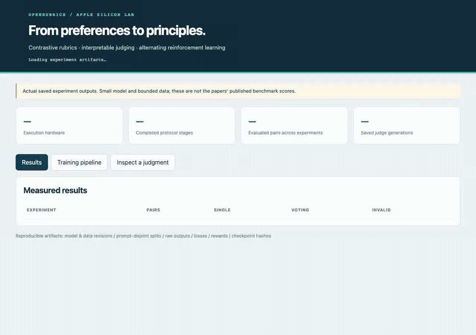
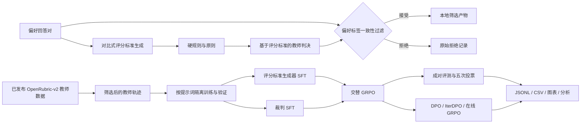
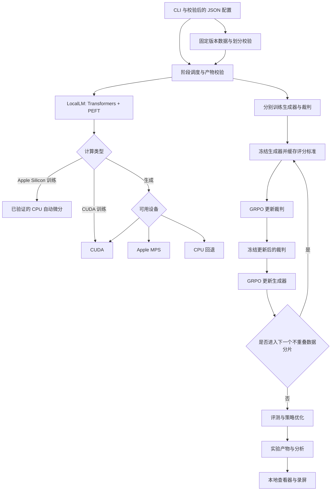
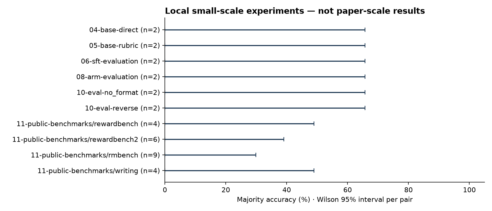
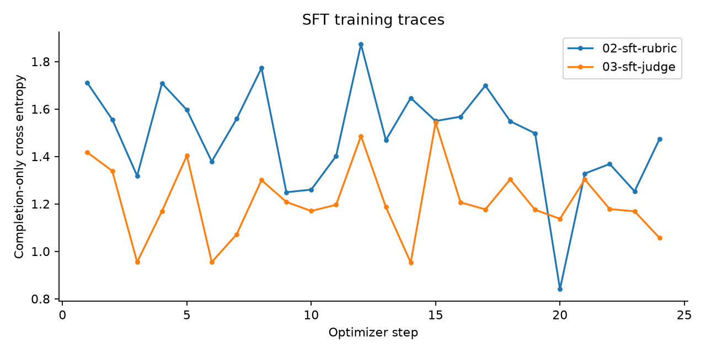

# RubricLab

[English（默认）](README.md) | **简体中文**

基于 OpenRubrics、适配 Apple Silicon 的评分标准奖励建模研究工具，支持端到端训练、评测与可复现的实验分析。

通过显式评分标准训练生成器和裁判，再用交替强化学习优化两者。本项目保留原始 **OpenRubrics / Rubric-RM / Rubric-ARM** 实现，并新增可在 **M1 Mac** 上端到端执行的研究流程，使用经过梯度核查的 CPU 训练、MPS 推理，以及留有记录的 CPU 推理回退。

[OpenRubrics 论文](https://arxiv.org/abs/2510.07743) · [Rubric-ARM 论文](https://arxiv.org/abs/2602.01511) · [模型与数据](https://huggingface.co/OpenRubrics) · [论文覆盖审计](docs/PAPER_COVERAGE.md) · [原始 README 与引用](docs/UPSTREAM_README.md)

> **范围说明：** 本地流程以缩小规模执行核心算法，**不代表完成全部论文实验，也不声称复现论文指标**。16GB M1 无法容纳原论文的 8B 全参数训练。论文特定的衍生评测数据、外部裁判及未完成实验已在[覆盖审计](docs/PAPER_COVERAGE.md)中明确列出。

## 演示

录屏展示本地查看器读取**真实保存的模型输出及实验结果**，包括失败情况。它是已完成实验的回放，不表示训练能在视频时长内完成。

[](docs/assets/demo.mp4)

[播放／下载 MP4](docs/assets/demo.mp4) · [自动播放视频页面](docs/demo.html)

<video src="docs/assets/demo.mp4" poster="docs/assets/demo-poster.png" autoplay muted loop playsinline controls width="960">
  <a href="docs/assets/demo.mp4">打开演示视频</a>
</video>

GitHub README 无法可靠地强制 MP4 自动播放，因此同时提供可直接自动循环的 GIF 预览和 MP4 视频。独立 HTML 页面使用 `autoplay muted loop playsinline`，仍受浏览器媒体偏好限制。不需要上传到外部视频平台。

## 在 M1 Mac 上运行

本地验证环境：**Apple M1 Pro、16GB 统一内存、arm64 macOS、Python 3.11**。请使用原生 arm64 Python，不使用 Rosetta。只有重新录制视频才需要 FFmpeg。

如需安装前置依赖，可使用 Homebrew：`brew install python@3.11`；重新录制视频时再安装 `brew install ffmpeg`。

```bash
git clone https://github.com/InfronAI/RubricLab.git
cd RubricLab
python3.11 -m venv .venv
source .venv/bin/activate
python -m pip install -e '.[dev,demo]'
openrubrics doctor

# 直接使用项目保存的小规模数据切片。
openrubrics run --config configs/m1.json --data data/m1 \
  --output experiments/my-m1-run

openrubrics report experiments/my-m1-run
openrubrics demo --run experiments/my-m1-run
# 浏览器打开 http://127.0.0.1:8765
```

未缓存模型时，首次加载会下载公开权重。默认流程**不需要 API Key、不调用付费模型、不依赖 CUDA，也不创建远程计算任务**。主配置包含三轮 ARM、两项消融和五次投票评测，完整本地流程需要预留数小时；较短的执行检查可先使用下面的 smoke 配置。

重新准备数据，或执行更短的机制验证：

```bash
# 使用新目录，保留已有数据的来源记录。
openrubrics prepare --config configs/m1.json --output data/my-m1
openrubrics run --config configs/m1.json --data data/my-m1 \
  --output experiments/my-rebuilt-run

# 更小的模型和训练预算。
openrubrics prepare --config configs/smoke.json --output data/my-smoke
openrubrics run --config configs/smoke.json --data data/my-smoke \
  --output experiments/my-smoke-run
```

| 配置 | 基座模型 | 用途 |
|---|---|---|
| `configs/m1.json` | Qwen2.5-0.5B-Instruct | SFT、三轮 ARM、消融、公开评测切片、策略优化 |
| `configs/smoke.json` | SmolLM2-135M-Instruct | 较短的机制验证；一轮 ARM，不遍历公开评测集 |
| 原始 GPU 配置 | Qwen3-4B/8B 全参数训练 | 原论文模型规模；需要独立 CUDA 环境及足够硬件 |

两种本地配置均使用真实预训练模型及梯度更新。小模型可能生成无效判决、无法通过一致性过滤，或产生没有区分度的奖励；这些结果会保存，不会被标准答案替换。

## Apple Silicon 改造

[已完成的 CPU smoke 实验](experiments/smoke-cpu-20261116/analysis/NOTES.md)在本机约耗时 10 分钟，13 个阶段的产物均通过恢复核验。其小模型的留出集判断无效，因此这里只证明链路可执行，不代表对齐效果。

[工程说明](docs/M1_ENGINEERING.md)记录各项优化的验证方式、实测数据与适用边界。

- 统一安装包和 CLI，串联数据准备、训练、评测、策略优化、报告及查看器。
- Apple Silicon 使用 MPS 推理，**训练与策略／参考概率计算使用 CPU 自动微分**。固定权重的梯度及有限差分核查发现，当前环境的 MPS 反向结果不可靠，因此默认不使用 MPS 训练。两条路径均为 FP32，不需要 BF16、FlashAttention、bitsandbytes、Triton、vLLM 或 DeepSpeed。
- 独立 LoRA 适配器、梯度检查点及**精确分块输出层交叉熵**降低内存占用。只计算回答 token 的词表分布，保留原始下一 token 训练目标和最终判决。
- 顺序加载模型、独立训练子进程，每批 MPS 推理也使用独立进程。固定 KV 缓存避免解码时不断累积 Metal 图；批量投票和按提示词缓存评分标准减少重复计算。
- 超长输入明确报错；按提示词隔离训练／验证集；记录模型及数据版本、输入／代码哈希、随机种子、原始输出、损失、奖励及权重哈希。
- 遇到已知 MPS 生成故障时，用相同模型、提示词和种子在 CPU 重试，并逐条记录设备及回退原因。独立 MPS 子进程的等待上限为五分钟，包含加载时间；超时后先终止并回收该进程，再创建新的 CPU 子进程重试。
- 校验已有产物后从阶段边界恢复。原入口还修复了 API 提前导入、JSON 花括号、输入占位路径、评分标准元数据、条目解析及模糊投票等问题。

## 数据流图



当前配置使用已发布的教师轨迹进行 SFT。本地 CRG 是单独测量的阶段，不会自动接入 SFT；接受和拒绝的记录分别保存。不会宣称已发布的教师数据是由本地小模型生成的。

## 结构与训练流程图



裁判推理提示词不包含标准偏好标签。评分标准策略在推理及 ARM 中只看到用户请求，排序后的回答仅用于对比式数据生成。每个 ARM 阶段冻结另一个组件，跨轮次保持 SFT 参考模型不变。

## 实验与分析

[综合分析](experiments/RESULTS.zh-CN.md)汇总主实验、受控诊断及官方 IFEval 策略检查，并提供[英文版本](experiments/RESULTS.md)。

[实验协议](docs/EXPERIMENT_PROTOCOL.md)定义了阶段、指标及局限。[M1 运行清单](experiments/m1-cpu-training-20261116/manifest.json)保存实际环境和阶段凭据；[分析报告](experiments/m1-cpu-training-20261116/analysis/REPORT.md)、[CSV 指标](experiments/m1-cpu-training-20261116/analysis/metrics.csv)及[原始输出](experiments/m1-cpu-training-20261116/)均保存在项目中。



图中展示投票准确率及描述性置信区间。柱高为零仍表示实测准确率为 0%，不能把向上延伸的区间误读成正准确率。先前的 MPS 训练尝试未通过梯度核查，仅作为[数值诊断记录](experiments/m1-complete-20261116/validity.json)保留；当前实验不会复用其训练权重。



公开数据适配覆盖 **RewardBench、RewardBench2、RM-Bench、WritingPreferenceBench**。本地切片保留完整比较组；无效生成计入分母，多数投票无法确定胜者时弃权；RewardBench2 额外记录组内全部比较正确率。[数据来源说明](data/README.md)记录署名和筛选偏差。

可选的[官方 IFEval 检查](docs/EXPERIMENT_PROTOCOL.md#official-ifeval-policy-check)使用固定版本的 Google strict／loose 验证器评测策略输出。[独立的输出预算诊断](experiments/supplementary/)固定 SFT 权重，对比 128／320、128／768、320／1024 tokens 的 rubric／裁判预算。[教师长度核查](experiments/supplementary/teacher-target-lengths.json)解释了主配置预算为何偏紧。这些有界实验与主配置分开报告，并保留[较大预算配置](experiments/supplementary/long-two-stage-config.json)。

[补充协议](experiments/supplementary/README.md)还包含固定版本的 **HelpSteer3、PPE-IFEval 与 THU-KEG IFBench** 回答对诊断，保留人类／验证器标签及来源证据。这些诊断不能代替完整官方基准的聚合得分。

若 ARM 裁判没有给出交换顺序后仍一致的偏好，DPO 阶段会记录跳过及零次更新。组内奖励方差为零的 GRPO 不提供偏好梯度信号。程序执行成功**不等于对齐效果提升**。源标签 DPO 基线单独记录；极小样本指标不能与论文完整评测表直接比较。

## 常用命令

```bash
# 为自己的回答对生成评分标准并判决。
openrubrics judge --instruction 'Reply with exactly one greeting word.' \
  --a 'Hello' --b 'Hello, how are you today?' \
  --output experiments/my-judgment.json

# 用训练后的适配器评测已验证的 JSONL 回答对。
openrubrics evaluate --data pairs.jsonl \
  --rubric-adapter experiments/my-m1-run/02-sft-rubric \
  --judge-adapter experiments/my-m1-run/03-sft-judge \
  --output experiments/custom-evaluation

# 恢复前会核对代码、配置、输入与已完成产物。
openrubrics run --config configs/m1.json --data data/m1 \
  --output experiments/my-m1-run --resume

# 显式使用 CPU。
openrubrics run --config configs/smoke.json --data data/my-smoke \
  --output experiments/my-cpu-run --device cpu

# 核心测试不下载模型。
python -m pytest -q
ruff check src tests
```

外部 JSONL 必须包含 `id`、`instruction`、`response_a`、`response_b` 及 `label: "A" | "B"`。可选 `subset`、`group_id`、`source`、`source_revision` 用于保留来源。可在 Python 3.11 虚拟环境中运行 `pip install -r requirements-macos.lock.txt` 复建实测依赖版本。

安装 FFmpeg 后，可从自己已完成的实验重新录制真实查看器：

```bash
python -m playwright install chromium
python scripts/record_demo.py --run experiments/my-m1-run
```

录制脚本将 MP4、循环 GIF、封面、媒体哈希及浏览器错误检查结果保存到 `docs/assets/`。生成计时不含子进程启动与模型加载，完整阶段耗时包含这些开销。子进程超时后，生成计时取自 CPU 重试，子进程及阶段的墙钟耗时还包含失败尝试。M1 主配置在 16 GB 机器上验证；8 GB Mac 可先使用 smoke 配置，本次没有 8 GB 实机验证。

## 目录

```text
src/openrubrics_lab/   可移植后端、数据、损失、实验、CLI 与查看器
configs/              M1 与 smoke 的显式预算
tests/               数学与数据完整性回归测试
data/                实际数据切片及版本／哈希清单
experiments/         真实输出、本地适配器、指标与分析
docs/                论文覆盖审计、实验协议及录屏
openrubrics/         原始云端数据生成流程
rubric-rm/           原始 LLaMA-Factory 训练与 GPU 评测
rubric-arm/          原始 ms-swift GRPO 脚本与奖励插件
```

## 原论文规模、引用与许可证

原始[数据生成](openrubrics/README.md)、[Rubric-RM](rubric-rm/README.md)、[Rubric-ARM](rubric-arm/README.md)说明仍保留。请为 CUDA 路径创建独立环境。本地路径可设置 `prompt_style: "original"` 使用保留的原始提示词。完整论文复现所需的附加数据及协议见[覆盖审计](docs/PAPER_COVERAGE.md)。

请引用[原始论文](docs/UPSTREAM_README.md#citation)。[RUBRIC-ARROW](https://github.com/Haoxiang03/RUBRIC-ARROW) 属于独立上游项目。软件采用 [MIT](LICENSE)；数据及模型遵循各自来源仓库的许可证。
