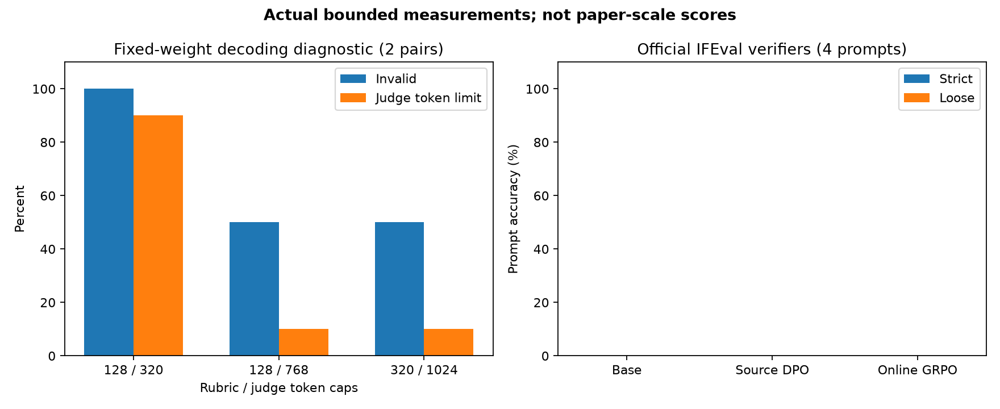

# Actual local experiment results

[简体中文](RESULTS.zh-CN.md)

The primary Qwen2.5-0.5B / LoRA protocol completed 17 stage receipts on an Apple M1 Pro (16 GB), with CPU training/scoring and MPS generation with recorded CPU retries, including three standard ARM rounds, two ablations, four public benchmark slices and downstream policy paths. All 386 recorded stage artifact hashes match. The current completed-stage receipts total 150.8 minutes; this excludes retired attempts and supplementary jobs. The separate 135M CPU smoke run completed in about 10 minutes.

An earlier MPS-training run failed a [fixed-weight gradient and finite-difference audit](../docs/GRADIENT_AUDIT.md). Its finite losses did not establish correct backward gradients. This report uses a fresh CPU-autograd run; no trained weights from that attempt were reused. The old artifacts remain explicitly marked as diagnostic only.

During public-benchmark evaluation, one long-input MPS worker exceeded 20 minutes under heavy swapping. A reviewed recovery fix added a five-minute worker deadline and a fresh CPU retry with unchanged weights, prompts, seeds and decoding budgets. The incomplete benchmark stage was archived and fully rerun; completed CPU training was retained. The manifest's code-fix history and source snapshots preserve this boundary. See the [engineering notes](../docs/M1_ENGINEERING.md).

These are real small-scale executions, **not a reproduction of the papers' model scale or published scores**. Some stages finish by correctly skipping an empty optimization set. See the [coverage audit](../docs/PAPER_COVERAGE.md) for unexecuted original-scale work.

## Pairwise results

| Experiment | Pairs | Voting accuracy | Invalid | Token limit | Judge devices |
|---|---:|---:|---:|---:|---|
| 04-base-direct | 2 | 0.0% | 10.0% | 0.0% | mps |
| 05-base-rubric | 2 | 0.0% | 60.0% | 10.0% | mps |
| 06-sft-evaluation | 2 | 0.0% | 100.0% | 90.0% | mps |
| 08-arm-evaluation | 2 | 0.0% | 100.0% | 100.0% | mps |
| 10-eval-no_format | 2 | 0.0% | 100.0% | 90.0% | mps |
| 10-eval-reverse | 2 | 0.0% | 100.0% | 100.0% | mps |
| 11-public-benchmarks/rewardbench | 4 | 0.0% | 95.0% | 95.0% | mps |
| 11-public-benchmarks/rewardbench2 | 6 | 0.0% | 83.3% | 83.3% | cpu / mps |
| 11-public-benchmarks/rmbench | 9 | 0.0% | 95.6% | 86.7% | cpu / mps |
| 11-public-benchmarks/writing | 4 | 0.0% | 85.0% | 80.0% | mps |
| supplementary/long-decode-sft | 2 | 0.0% | 50.0% | 10.0% | mps |
| supplementary/long-two-stage-sft | 2 | 0.0% | 50.0% | 10.0% | cpu |
| supplementary/order-sft | 2 | 0.0% | 70.0% | 70.0% | mps |
| supplementary/order-arm | 2 | 0.0% | 90.0% | 90.0% | mps |
| supplementary/eval-helpsteer3 | 2 | 0.0% | 100.0% | 100.0% | mps |
| supplementary/eval-ppe-ifeval | 2 | 0.0% | 90.0% | 80.0% | mps |
| supplementary/eval-ifbench | 2 | 0.0% | 90.0% | 100.0% | mps |

Pairs repeat across variants, and multiple benchmark comparisons share prompts. Counts are not numbers of independent test tasks. Both primary held-out evaluation labels are B; the full four-row validation slice is also B-only. Training has 8 A and 16 B labels. This small, imbalanced sample cannot establish general preference accuracy. Benchmark response order is independently shuffled with a fixed seed.

Across the four public benchmark slices, individual sampled judgments included 6 correct, 5 valid-but-wrong and 104 invalid outputs. Of the invalid outputs, 97 reached the token cap, 7 stopped before it, and 0 had no generation record. A token-limit flag and an invalid decision are distinct measurements: a model may emit a decision and continue, or stop without one.

## Decoding budget and order

With unchanged SFT weights, raising the judge cap from 320 to 768 tokens changed invalid output from 100.0% to 50.0%, token-limit frequency from 90.0% to 10.0%, and voting accuracy from 0.0% to 0.0%. This is a separate diagnostic, not a replacement of the primary result. Inspect raw texts before attributing every failure to truncation. The compact prompt's brevity request and the original long teacher trajectories are not perfectly matched. Its format illustration also uses `Winner: A`; this run does not separately isolate any position effect caused by that example. These are possible prompt confounds, not established explanations for every failure.

The rubric cap remains 128 tokens in both settings; 2/2 unique SFT evaluation rubrics reached that limit. Increasing only the judge budget therefore does not test a fully unconstrained two-stage pipeline. The joint-budget check below addresses this additional limitation.

The primary, judge-only and joint-budget judgments ran on `['mps']`, `['mps']` and `['cpu']`, respectively; 10 joint-budget votes used CPU recovery. CPU and MPS sampling are not promised to produce identical tokens for the same seed. This is therefore not a device-controlled causal estimate of generation-budget effects. The [analysis amendment](supplementary/provenance/analysis-device-note.json) records this reporting correction without changing data or metrics.

The [teacher-length audit](supplementary/teacher-target-lengths.json) found that all 24 training judgments exceed 320 tokens (median 573), while 19/24 rubrics exceed 128 tokens (median 175.5). This prompted a separate exploratory run with rubric/judge caps of 320/1024 and context 4096, declared before supplementary execution. With the same SFT weights and pairs, invalid output was 50.0%, judge token-limit frequency 10.0%, and voting accuracy 0.0%; 1/2 rubrics reached their new cap. It changes both budgets, so it cannot attribute an effect to either one alone. Teacher target lengths do not guarantee that the small model will terminate at those lengths.

| Actor pair | Tested pairs | Identical rubrics | Valid controlled comparisons | Consistency |
|---|---:|---:|---:|---:|
| sft | 2 | 2 | 0 | n/a |
| arm | 2 | 2 | 0 | n/a |

The supplementary order check matches five votes, temperature 0.7 and seeds; comparisons additionally require identical generated rubrics and valid votes in both directions. The primary single reversed generation uses greedy decoding and cannot isolate position effects. No valid comparable decisions means the consistency rate is undefined, not evidence of zero position bias.

## What the updates actually learned

| Variant | Round | Actor | Correctness reward | Total reward | Zero-variance groups | Max gradient norm |
|---|---:|---|---:|---:|---:|---:|
| 07-arm | 1 | judge | 0.0000 | 0.1364 | 0 | 1.005160 |
| 07-arm | 1 | rubric | 0.0000 | 0.0000 | 1 | 0.000000 |
| 07-arm | 2 | judge | 0.0000 | 0.0152 | 0 | 1.117082 |
| 07-arm | 2 | rubric | 0.0000 | 0.0000 | 1 | 0.000003 |
| 07-arm | 3 | judge | 0.0000 | 0.0606 | 0 | 1.088940 |
| 07-arm | 3 | rubric | 0.0000 | 0.0000 | 1 | 0.000023 |
| 09-ablation-reverse | 1 | rubric | 0.0000 | 0.0000 | 1 | 0.000000 |
| 09-ablation-reverse | 1 | judge | 0.0000 | 0.1364 | 0 | 1.005160 |
| 09-ablation-reverse | 2 | rubric | 0.0000 | 0.0000 | 1 | 0.000003 |
| 09-ablation-reverse | 2 | judge | 0.0000 | 0.0152 | 0 | 1.117082 |
| 09-ablation-reverse | 3 | rubric | 0.0000 | 0.0000 | 1 | 0.000023 |
| 09-ablation-reverse | 3 | judge | 0.0000 | 0.0606 | 0 | 1.088940 |
| 09-ablation-no_format | 1 | judge | 0.0000 | 0.0000 | 1 | 0.000000 |
| 09-ablation-no_format | 1 | rubric | 0.0000 | 0.0000 | 1 | 0.000000 |
| 09-ablation-no_format | 2 | judge | 0.0000 | 0.0000 | 1 | 0.000003 |
| 09-ablation-no_format | 2 | rubric | 0.0000 | 0.0000 | 1 | 0.000003 |
| 09-ablation-no_format | 3 | judge | 0.0000 | 0.0000 | 1 | 0.000032 |
| 09-ablation-no_format | 3 | rubric | 0.0000 | 0.0000 | 1 | 0.000023 |

The table separates correctness rewards from total rewards, which also contain format shaping for judge phases. A nonzero gradient driven by formatting is not evidence of improved correctness. Zero-variance groups supply no preference advantage; fixed-reference KL and optimizer effects may still change weights. SFT losses compare different training examples and are not validation-loss curves.

Fresh local CRG retained 0 of 3 attempts. SFT used the separately released teacher-curated data, not invented successful local CRG records.

ARM-labeled DPO: `skipped_no_consistent_pairs`, 0 steps. Separate source-label DPO: 4 steps. IterDPO completed 2 rounds with step counts [0, 0]. Online GRPO had 1/2 zero-variance groups and mean reward 0.0833. Empty ARM labels were never replaced with source labels.

The online judge awarded 0 full two-order wins and 1 half-credit rewards; 1 half-credit cases had only one valid judgment direction. Such rewards can reflect output-format reliability rather than a demonstrated preference improvement. The maximum pre-clipping CPU gradient norm was 0.494295, with a clipping threshold of 1. These are judge rewards, not independent instruction-following scores.

## Official IFEval policy checks

| Policy | Prompts | Strict prompt | Loose prompt | Strict instruction | Loose instruction |
|---|---:|---:|---:|---:|---:|
| base | 4 | 0.0% | 0.0% | 0.0% | 0.0% |
| source-dpo | 4 | 0.0% | 0.0% | 0.0% | 0.0% |
| online-grpo | 4 | 0.0% | 0.0% | 0.0% | 0.0% |

These four seeded prompts use official strict/loose verifiers and a 512-token response cap. Their low sample size and output budget limit interpretation. The source-DPO policy is a baseline; its score is not attributed to ARM-generated preference labels.

ARM-DPO and IterDPO policy checks are included only if those stages actually produced trained adapters. Empty accepted sets do not create substitute policy scores.

## Reproducibility and remaining limits

[Combined JSON](supplementary/combined.json), [CSV](supplementary/combined-metrics.csv), [primary raw artifacts](m1-cpu-training-20261116/), and [supplementary raw artifacts](supplementary/) contain the evidence. Model/data revisions, code snapshots, failed runs, token IDs, rewards and checkpoint hashes are retained. [Engineering measurements](../docs/M1_ENGINEERING.md) distinguish sampled driver allocations from whole-process memory. The final cache-backed continuation used no hosted model APIs.

The experiments do not establish improved alignment or reproduce the theorem's empirical premises. Full 4B/8B training, original-scale data and model sweeps, external reward-model baselines, derived FollowBench/InfoBench pairs, external-judge policy benchmarks and clinical-domain transfer remain unexecuted. No scores were fabricated for those cells.
