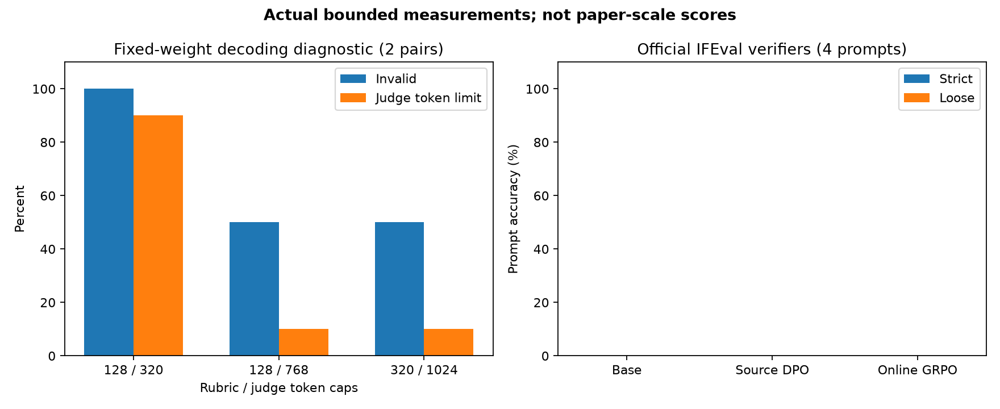

# 本地真实实验结果

[English](RESULTS.md)

主实验在 Apple M1 Pro（16 GB）上以 Qwen2.5-0.5B／LoRA、CPU 训练及概率计算、MPS 生成及有记录的 CPU 重试完成 17 个阶段凭据，包括三轮标准 ARM、两项消融、四套公开基准切片及下游策略路径。386 个阶段产物哈希全部核验通过。当前有效阶段的耗时合计 150.8 分钟，不含已退役的诊断尝试与补充实验。独立的 135M CPU smoke 流程约耗时 10 分钟。

先前的 MPS 训练未通过[固定权重梯度及有限差分核查](../docs/GRADIENT_AUDIT.md)，损失为有限数并不代表反向梯度正确。本报告使用重新从基础模型开始的 CPU 自动微分实验，不复用旧尝试的训练权重；旧产物明确标记为仅供诊断。

公开基准评测时，一批长输入的 MPS 子进程在高换页压力下运行超过 20 分钟。经过审查的恢复修复加入了五分钟子进程上限，超时后用相同权重、提示词、种子及解码预算在新 CPU 进程重试。未完成的基准阶段已归档并完整重跑，已完成的 CPU 训练保留。清单中的代码修复记录及源码快照保留这一边界，详见[工程说明](../docs/M1_ENGINEERING.md)。

这是真实的小规模执行，**不是论文模型规模与发表分数的复现**。部分阶段因没有有效偏好标签而正确跳过优化。原始规模实验的缺口见[覆盖审计](../docs/PAPER_COVERAGE.md)。

## 回答对评测

| Experiment | Pairs | Voting accuracy | Invalid | Token limit | Judge devices |
|---|---:|---:|---:|---:|---|
| 04-base-direct | 2 | 0.0% | 10.0% | 0.0% | mps |
| 05-base-rubric | 2 | 0.0% | 60.0% | 10.0% | mps |
| 06-sft-evaluation | 2 | 0.0% | 100.0% | 90.0% | mps |
| 08-arm-evaluation | 2 | 0.0% | 100.0% | 100.0% | mps |
| 10-eval-no_format | 2 | 0.0% | 100.0% | 90.0% | mps |
| 10-eval-reverse | 2 | 0.0% | 100.0% | 100.0% | mps |
| 11-public-benchmarks/rewardbench | 4 | 0.0% | 95.0% | 95.0% | mps |
| 11-public-benchmarks/rewardbench2 | 6 | 0.0% | 83.3% | 83.3% | cpu / mps |
| 11-public-benchmarks/rmbench | 9 | 0.0% | 95.6% | 86.7% | cpu / mps |
| 11-public-benchmarks/writing | 4 | 0.0% | 85.0% | 80.0% | mps |
| supplementary/long-decode-sft | 2 | 0.0% | 50.0% | 10.0% | mps |
| supplementary/long-two-stage-sft | 2 | 0.0% | 50.0% | 10.0% | cpu |
| supplementary/order-sft | 2 | 0.0% | 70.0% | 70.0% | mps |
| supplementary/order-arm | 2 | 0.0% | 90.0% | 90.0% | mps |
| supplementary/eval-helpsteer3 | 2 | 0.0% | 100.0% | 100.0% | mps |
| supplementary/eval-ppe-ifeval | 2 | 0.0% | 90.0% | 80.0% | mps |
| supplementary/eval-ifbench | 2 | 0.0% | 90.0% | 100.0% | mps |

各变体重复使用留出样本，部分基准比较共享提示词，因此表中条数不是独立任务数。主评测的两条标准偏好均为 B，完整四条验证切片也均为 B；24 条训练数据中 A/B 为 8/16。这种极小且不平衡的切片不能代表总体偏好能力。公开基准的回答顺序使用固定种子独立打乱。

四套公开基准的逐次判定中，正确 6 次，有效但判错 5 次，无效 104 次。无效输出中，97 次达到长度上限，7 次提前停止，0 次没有生成记录。达到 token 上限与判定无效是不同指标：模型可能先给出判定再继续生成，也可能提前停止却没有给出判定。

## 输出预算与顺序控制

固定 SFT 权重、样本和五票设置，将裁判预算从 320 提高至 768 tokens 后，无效输出率由 100.0% 变为 50.0%，达到长度上限的比例由 90.0% 变为 10.0%，投票准确率由 0.0% 变为 0.0%。这是独立诊断，不替换主实验结果。不能把所有错误都归因于截断；紧凑提示词的简短要求与较长教师轨迹不完全匹配，格式示例还使用了 `Winner: A`。本实验未单独识别这些提示词因素及示例可能引入的位置影响，不能将其视为所有失败的已证实原因。

两种设置的 rubric 预算均保持 128 tokens；SFT 评测中 2/2 条独立 rubric 达到了长度上限。因此，仅放宽裁判预算并不等于验证了完整、无限长的两阶段流程；下面的双预算诊断进一步检查这一限制。

主配置、仅放宽裁判预算、双预算配置的实际裁判设备分别为 `['mps']`、`['mps']`、`['cpu']`；双预算配置中有 10 次判决通过 CPU 回退完成。CPU 与 MPS 即使使用相同种子，也不保证逐 token 一致，因此这不是严格控制设备后的纯预算因果实验。[分析修订记录](supplementary/provenance/analysis-device-note.json)保存了这一说明的变更，不改变实验数据或指标。

[教师长度核查](supplementary/teacher-target-lengths.json)发现：24 条训练判决全部超过 320 tokens，中位数为 573；19/24 条 rubric 超过 128 tokens，中位数为 175.5。因此，在补充实验执行前另行声明了探索性的双预算诊断：rubric／判决上限为 320／1024、上下文为 4096，权重与样本保持不变。其无效率为 50.0%，裁判达到上限的比例为 10.0%，投票准确率为 0.0%；1/2 条 rubric 达到了新上限。该实验同时改变了两项预算，不能将变化单独归因于其中一项；教师目标长度也不保证小模型会在相同长度结束。

| Actor pair | Tested pairs | Identical rubrics | Valid controlled comparisons | Consistency |
|---|---:|---:|---:|---:|
| sft | 2 | 2 | 0 | n/a |
| arm | 2 | 2 | 0 | n/a |

补充顺序检查在正反顺序下保持五票、温度 0.7 和随机种子一致；有效受控比较还要求生成的 rubric 完全一致、正反两侧投票均有效。主配置的单次反序输出采用贪心解码，只能作为混合解码诊断。如果没有符合条件的比较，顺序一致率为未定义，不能解释为不存在位置偏差。

## 实际优化信号

| Variant | Round | Actor | Correctness reward | Total reward | Zero-variance groups | Max gradient norm |
|---|---:|---|---:|---:|---:|---:|
| 07-arm | 1 | judge | 0.0000 | 0.1364 | 0 | 1.005160 |
| 07-arm | 1 | rubric | 0.0000 | 0.0000 | 1 | 0.000000 |
| 07-arm | 2 | judge | 0.0000 | 0.0152 | 0 | 1.117082 |
| 07-arm | 2 | rubric | 0.0000 | 0.0000 | 1 | 0.000003 |
| 07-arm | 3 | judge | 0.0000 | 0.0606 | 0 | 1.088940 |
| 07-arm | 3 | rubric | 0.0000 | 0.0000 | 1 | 0.000023 |
| 09-ablation-reverse | 1 | rubric | 0.0000 | 0.0000 | 1 | 0.000000 |
| 09-ablation-reverse | 1 | judge | 0.0000 | 0.1364 | 0 | 1.005160 |
| 09-ablation-reverse | 2 | rubric | 0.0000 | 0.0000 | 1 | 0.000003 |
| 09-ablation-reverse | 2 | judge | 0.0000 | 0.0152 | 0 | 1.117082 |
| 09-ablation-reverse | 3 | rubric | 0.0000 | 0.0000 | 1 | 0.000023 |
| 09-ablation-reverse | 3 | judge | 0.0000 | 0.0606 | 0 | 1.088940 |
| 09-ablation-no_format | 1 | judge | 0.0000 | 0.0000 | 1 | 0.000000 |
| 09-ablation-no_format | 1 | rubric | 0.0000 | 0.0000 | 1 | 0.000000 |
| 09-ablation-no_format | 2 | judge | 0.0000 | 0.0000 | 1 | 0.000003 |
| 09-ablation-no_format | 2 | rubric | 0.0000 | 0.0000 | 1 | 0.000003 |
| 09-ablation-no_format | 3 | judge | 0.0000 | 0.0000 | 1 | 0.000032 |
| 09-ablation-no_format | 3 | rubric | 0.0000 | 0.0000 | 1 | 0.000023 |

表格区分正确性奖励与包含格式塑形的总奖励。由格式差异产生的非零梯度不代表判断正确率提升。奖励方差为零的组没有偏好优势信号，但固定参考 KL 与优化器效应仍可能使权重变化。SFT 各步使用不同样本，损失曲线不等于验证集学习曲线。

本地 CRG 的 3 次尝试保留了 0 条；SFT 使用独立发布的教师筛选数据，没有伪造本地 CRG 成功样本。

ARM 标签 DPO 状态为 `skipped_no_consistent_pairs`，执行 0 步。独立源标签 DPO 执行 4 步。IterDPO 共 2 轮，各轮更新次数为 [0, 0]。在线 GRPO 的 2 组中有 1 组奖励方差为零，平均奖励为 0.0833。没有用源标签填补 ARM 的无效标签。

在线裁判给出 0 次双顺序全胜及 1 次半额奖励；其中 1 次半额奖励只有一个顺序的判决有效。这类奖励可能反映输出格式的可靠程度，不能直接证明偏好能力提升。CPU 裁剪前最大梯度范数为 0.494295，裁剪上限为 1。这些是裁判奖励，不是独立的指令遵循得分。

## 官方 IFEval 策略检查

| Policy | Prompts | Strict prompt | Loose prompt | Strict instruction | Loose instruction |
|---|---:|---:|---:|---:|---:|
| base | 4 | 0.0% | 0.0% | 0.0% | 0.0% |
| source-dpo | 4 | 0.0% | 0.0% | 0.0% | 0.0% |
| online-grpo | 4 | 0.0% | 0.0% | 0.0% | 0.0% |

四条固定种子选出的提示词使用官方 strict／loose 验证器，每条输出预算为 512 tokens。样本量及长度预算限制了结论；源标签 DPO 的分数属于独立基线，不能归功于 ARM 偏好标签。

只有 ARM-DPO 或 IterDPO 实际产生训练后的适配器时，才增加相应策略评测；空标签集不会被替换成其他策略的分数。

## 证据与未完成范围

[汇总 JSON](supplementary/combined.json)、[CSV](supplementary/combined-metrics.csv)、[主实验原始记录](m1-cpu-training-20261116/)与[补充原始记录](supplementary/)保留实际证据。模型／数据版本、代码快照、失败尝试、token、奖励和权重哈希均已记录。[工程说明](../docs/M1_ENGINEERING.md)区分了 MPS 分配量与整进程物理内存。后续离线运行没有调用托管模型 API。

这些结果不足以证明对齐效果提升，也不是理论定理的实验验证。原始 4B／8B 全量训练、原规模数据及模型比较、外部奖励模型基线、FollowBench／InfoBench 派生回答对、依赖外部裁判的策略基准及医疗领域迁移尚未执行；对应结果没有填入虚构分数。
